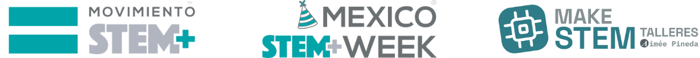

# Talleres STEM · México STEM Week 2026

**Aprendizaje práctico · Ideas sin límites**

Dos talleres gratuitos para explorar programación y electrónica creando proyectos paso a paso. No se necesita experiencia previa ni equipo especializado: basta con una computadora con conexión a internet.

## ¿Qué es México STEM Week?

México STEM Week es una iniciativa nacional de Movimiento STEM+ y sus aliados, en el marco del Día STEM en México. Reúne actividades que acercan la ciencia, la tecnología, la ingeniería y las matemáticas a personas de todo el país. La edición 2026 se realiza del 5 al 12 de noviembre.

## Talleres

| Fecha y hora (UTC-6) | Taller | Proyecto |
| --- | --- | --- |
| Sábado 7 de noviembre · 18:00–20:00 h | [Creación de videojuegos con Scratch](scratch/README.md) | Un videojuego de laberinto con personaje, obstáculos y meta. |
| Domingo 8 de noviembre · 18:00–20:00 h | [Creación de circuitos con Tinkercad](arduino/README.md) | Un circuito simulado con Arduino UNO R3 y tres LED. |

Ambos talleres son en línea, gratuitos, en español y abiertos a cualquier país. Dirigidos al público general a partir de los 13 años.

## Requisitos

- Computadora con conexión a internet.
- No se requiere experiencia previa.
- [Scratch](https://scratch.mit.edu/) para el taller de videojuegos.
- [Tinkercad](https://www.tinkercad.com/) para el taller de circuitos.

## Más información

- En vivo y detalles: [https://makestem.vercel.app/](https://makestem.vercel.app/)
- México STEM Week — actividades: [https://mexicostemweek.org/actividades/](https://mexicostemweek.org/actividades/)

## Organiza e imparte

**Aimée Pineda** es EdTech Developer e imparte talleres STEM prácticos y accesibles para personas que desean aprender desde cero.

Sitio web: [https://emelink.vercel.app/](https://emelink.vercel.app/)

## Licencia

Los materiales didácticos originales de estos talleres se comparten bajo la licencia [Creative Commons Atribución-CompartirIgual 4.0 Internacional (CC BY-SA 4.0)](https://creativecommons.org/licenses/by-sa/4.0/deed.es). Puedes compartirlos y adaptarlos dando crédito a Aimée Pineda e indicando los cambios; las adaptaciones deben compartirse bajo la misma licencia. Los logotipos y marcas conservan los derechos de sus respectivos titulares.

#STEMEstáEnTodosLados #MéxicoSTEMWeek #YoSoySTEM
