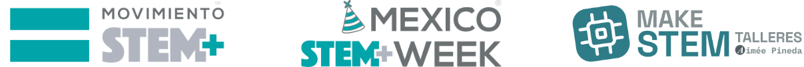

<div align="center">



# CREACIÓN DE CIRCUITOS CON TINKERCAD | TALLER #MéxicoSTEMWeek

**México STEM Week 2026 · Taller 02 · Electrónica creativa**

</div>

El taller aborda fundamentos de electrónica y programación mediante circuitos con Arduino UNO R3 en Tinkercad. Incluye el reconocimiento de componentes, la realización de conexiones, la aplicación de la Ley de Ohm y la programación con variables, funciones y ciclos, fortaleciendo el razonamiento lógico y la exploración de nuevas ideas.

## Información de la actividad

- **Fecha:** domingo 8 de noviembre de 2026
- **Horario:** 18:00 a 20:00 h (UTC-6)
- **Modalidad:** en línea y en vivo
- **Participación:** abierta a cualquier país
- **Idioma:** español
- **Costo:** gratuito
- **Público:** general, a partir de 13 años
- **Nivel:** principiante

## Reto

Simular un Arduino que encienda tres LED uno tras otro y repita la secuencia. Revisaremos las conexiones, el uso de resistencias y cómo cambiar el comportamiento con código.

## Temario

| Tiempo | Tema | Actividad |
| --- | --- | --- |
| 00–15 min | **Bienvenida y fundamentos** | Introducción al simulador Tinkercad, Arduino UNO R3 y los objetivos del taller. |
| 15–40 min | **Componentes, conexiones y Ley de Ohm** | Identificación de componentes y construcción de un circuito para analizar sus conexiones. |
| 40–90 min | **Programación de Arduino** | Resolución del reto paso a paso mediante variables, funciones y ciclos. |
| 90–110 min | **Pruebas y mejoras** | Simulación del circuito y ajuste de conexiones y código para corregir errores. |
| 110–120 min | **Resultados y preguntas** | Presentación de resultados y espacio para compartir preguntas e ideas. |

## Qué necesitas

- Una computadora con conexión a internet.
- No se requiere experiencia previa ni contar con una placa física de Arduino.
- Acceso a [Tinkercad](https://www.tinkercad.com/).

## Componentes del reto

- Arduino UNO R3 virtual.
- Tres LED de distintos colores.
- Tres resistencias para LED (por ejemplo, 220 Ω).
- Cables virtuales y protoboard (opcional).

Conecta el ánodo de cada LED (pata larga) a un pin digital mediante una resistencia y el cátodo (pata corta) a GND. En el ejemplo se usan los pines 8, 9 y 10.

## Código de ejemplo

```cpp
const int leds[] = {8, 9, 10};
const int cantidadLeds = 3;

void setup() {
  for (int i = 0; i < cantidadLeds; i++) {
    pinMode(leds[i], OUTPUT);
  }
}

void loop() {
  for (int i = 0; i < cantidadLeds; i++) {
    digitalWrite(leds[i], HIGH);
    delay(500);
    digitalWrite(leds[i], LOW);
  }
}
```

## Habilidades que practicarás

Electrónica básica · componentes y conexiones · Ley de Ohm · entradas y salidas digitales · variables · funciones · ciclos · simulación y depuración.

## Más información

- **En vivo y más detalles:** [https://makestem.vercel.app/](https://makestem.vercel.app/)
- **México STEM Week — actividades:** [https://mexicostemweek.org/actividades/](https://mexicostemweek.org/actividades/)

## Organiza e imparte

**Aimée Pineda** · [emelink.vercel.app](https://emelink.vercel.app/)

---

#STEMEstáEnTodosLados #MéxicoSTEMWeek #YoSoySTEM
