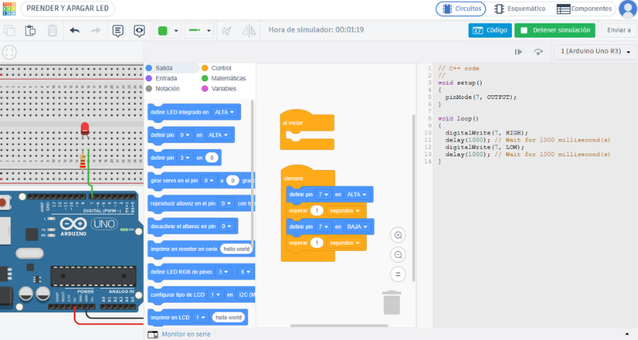

<div align="center">


# CREACIÓN DE CIRCUITOS CON TINKERCAD | TALLER #MéxicoSTEMWeek

**México STEM Week 2026 · Taller 02 · Electrónica creativa**

</div>

El taller aborda fundamentos de electrónica y programación mediante circuitos con Arduino UNO R3 en Tinkercad. Incluye el reconocimiento de componentes, la realización de conexiones, la aplicación de la Ley de Ohm y la programación con variables, funciones y ciclos, fortaleciendo el razonamiento lógico y la exploración de nuevas ideas.

## Índice

- [Información de la actividad](#información-de-la-actividad)
- [Requisitos](#requisitos)
- [Retos de programación](#retos-de-programación)
  - [Reto 1: Encender un LED](#reto-1-encender-un-led)
  - [Reto 2: Parpadeos según el número del pin](#reto-2-parpadeos-según-el-número-del-pin)
  - [Reto adicional: Controlar varios LED](#reto-adicional-controlar-varios-led)
- [Temario](#temario)
- [Componentes del reto](#componentes-del-reto)
- [Ley de Ohm: ¿cómo elegir una resistencia?](#ley-de-ohm-cómo-elegir-una-resistencia)
- [Código de ejemplo](#código-de-ejemplo)
- [Conceptos de programación para el taller](#conceptos-de-programación-para-el-taller)
  - [1. ¿Qué es un algoritmo?](#1-qué-es-un-algoritmo)
  - [2. ¿Qué es una variable?](#2-qué-es-una-variable)
  - [3. ¿Qué tipos de datos podemos guardar en una variable?](#3-qué-tipos-de-datos-podemos-guardar-en-una-variable)
  - [4. ¿Qué es una constante?](#4-qué-es-una-constante)
  - [5. ¿Qué significa inicializar?](#5-qué-significa-inicializar)
  - [6. ¿Qué operadores se utilizan en C++?](#6-qué-operadores-se-utilizan-en-c)
  - [7. ¿Para qué se utiliza `if`?](#7-para-qué-se-utiliza-if)
  - [8. ¿Qué es un ciclo?](#8-qué-es-un-ciclo)
  - [9. ¿Cuándo utilizo `while`?](#9-cuándo-utilizo-while)
  - [10. ¿Cuándo utilizo `for`?](#10-cuándo-utilizo-for)
  - [11. ¿Qué es una función?](#11-qué-es-una-función)
  - [12. ¿Qué es una función vacía o que no retorna nada?](#12-qué-es-una-función-vacía-o-que-no-retorna-nada)
  - [13. ¿Cuáles son los tipos de errores en programación?](#13-cuáles-son-los-tipos-de-errores-en-programación)
  - [14. ¿Cuáles son las reglas para nombrar variables en C++?](#14-cuáles-son-las-reglas-para-nombrar-variables-en-c)
- [Habilidades que se practican](#habilidades-que-se-practican)
- [Ejemplos de proyectos para continuar aprendiendo](#ejemplos-de-proyectos-para-continuar-aprendiendo)
- [Tutoriales para continuar aprendiendo](#tutoriales-para-continuar-aprendiendo)
- [Solución paso a paso: Creación de circuitos con Tinkercad](#solución-paso-a-paso-creación-de-circuitos-con-tinkercad)
- [¿Quién organiza e imparte?](#quién-organiza-e-imparte)
- [Más información](#más-información)
- [Licencia](#licencia)

## Información de la actividad

- **Fecha:** domingo 8 de noviembre de 2026
- **Horario:** 18:00 a 20:00 h (UTC-6)
- **Modalidad:** en línea y en vivo por YouTube
- **Transmisión en vivo:** [Creación de circuitos con Tinkercad](https://youtube.com/live/1a1yBBRa-ws?feature=share)
- **Participación:** abierta a cualquier país
- **Idioma:** español
- **Costo:** gratuito
- **Público:** general, a partir de 13 años
- **Nivel:** principiante

## Requisitos

- Una computadora con conexión a internet.
- No se requiere experiencia previa ni contar con una placa física de Arduino.
- Acceso a [Tinkercad](https://www.tinkercad.com/).

## Retos de programación

<div align="center">



</div>

### Reto 1: Encender un LED

El reto consiste en encender un LED conectado a la placa Arduino UNO R3 mediante un programa.

### Reto 2: Parpadeos según el número del pin

El reto consiste en conectar dos LED a pines digitales diferentes de una placa UNO R3 y desarrollar un programa en el que cada LED parpadee según el número del pin al que está conectado:

- Si el número del pin es par, el LED debe parpadear dos veces.
- Si el número del pin es impar, el LED debe parpadear tres veces.
- El LED conectado al pin par debe parpadear con intervalos de 1000 milisegundos.
- El LED conectado al pin impar debe parpadear con intervalos de 500 milisegundos.

### Reto adicional: Controlar varios LED

El reto adicional consiste en modificar el programa para que ambos LED parpadeen al mismo tiempo. Como extensión, se plantea cómo recorrer los pines digitales del 2 al 9 y controlar sus parpadeos sin escribir una llamada a `parpadear()` para cada LED.

## Temario

| Tiempo | Tema | Actividad |
| --- | --- | --- |
| 00–15 min | **Bienvenida y fundamentos** | Introducción al simulador Tinkercad, Arduino UNO R3 y los objetivos del taller. |
| 15–40 min | **Componentes, conexiones y Ley de Ohm** | Identificación de componentes y construcción de un circuito para analizar sus conexiones. |
| 40–90 min | **Programación de Arduino** | Resolución del reto paso a paso mediante variables, funciones y ciclos. |
| 90–110 min | **Pruebas y mejoras** | Simulación del circuito y ajuste de conexiones y código para corregir errores. |
| 110–120 min | **Resultados y preguntas** | Presentación de resultados y espacio para compartir preguntas e ideas. |

## Componentes del reto

- Arduino UNO R3 virtual.
- Dos LED de distintos colores.
- Tres resistencias para LED (por ejemplo, 220 Ω).
- Cables virtuales y protoboard (opcional).

La conexión de cada LED requiere que el ánodo (pata larga) se conecte a un pin digital mediante una resistencia y que el cátodo (pata corta) se conecte a GND. El código de ejemplo enciende y apaga el LED integrado del pin 13.

## Ley de Ohm: ¿cómo elegir una resistencia?

**Pregunta guía:** ¿Cómo podemos elegir la resistencia adecuada para proteger un LED conectado a Arduino?

Para calcularla, aplicamos la Ley de Ohm: `R = (Vfuente − VLED) / I`. Restamos el voltaje del LED al voltaje de la fuente y dividimos el resultado entre la corriente deseada, expresada en amperes. Para un LED conectado a una salida de 5 V de Arduino, revisamos el voltaje y la corriente recomendados para ese LED y elegimos una resistencia comercial igual o mayor al valor calculado.

Video de apoyo: [Ley de Ohm y elección de una resistencia](https://www.youtube.com/watch?v=r1KmLxYzJVA).

## Código de ejemplo

```cpp
const int pinLED = 13;

void setup() {
  pinMode(pinLED, OUTPUT);
}

void loop() {
  digitalWrite(pinLED, HIGH);
  delay(1000);
  digitalWrite(pinLED, LOW);
  delay(1000);
}
```

## Conceptos de programación para el taller

### 1. ¿Qué es un algoritmo?

Es un conjunto ordenado y finito de pasos o instrucciones que permiten resolver un problema o realizar una tarea.

Algunos ejemplos de algoritmos cotidianos son preparar un sándwich, cepillarse los dientes, cruzar una calle o calcular el promedio de tres calificaciones.

**Algoritmo para encender un LED:**

1. Configurar el pin como salida.
2. Encender el LED.
3. Esperar un segundo.
4. Apagar el LED.

### 2. ¿Qué es una variable?

Es un espacio en la memoria de la computadora donde se almacena un dato que puede utilizarse o modificarse durante un programa.

### 3. ¿Qué tipos de datos podemos guardar en una variable?

El tipo de dato indica qué clase de valor se guarda en una variable. Algunos tipos comunes en Arduino con C++ son:

| Tipo | Qué almacena | Ejemplo |
| --- | --- | --- |
| `int` | Números enteros | `int edad = 13;` |
| `float` | Números con decimales | `float voltaje = 5.0;` |
| `char` | Un carácter | `char inicial = 'A';` |
| `bool` | Un valor verdadero o falso | `bool encendido = true;` |
| `String` | Texto | `String mensaje = "Hola";` |

### 4. ¿Qué es una constante?

Es un dato cuyo valor no debe cambiar durante el programa. En C++ se declara con la palabra `const`. En el código de ejemplo, `const int pinLED = 13;` guarda el número del pin y evita que se cambie por accidente.

### 5. ¿Qué significa inicializar?

Es asignar un valor inicial a una variable cuando se declara o antes de comenzar a utilizarla. Por ejemplo: `int contador = 0;`.

### 6. ¿Qué operadores se utilizan en C++?

Los operadores permiten hacer cálculos y comparar o combinar condiciones. Estos son algunos de los más usados:

| Grupo | Operador | Significado | Ejemplo |
| --- | --- | --- | --- |
| Aritméticos | `+`, `-`, `*`, `/`, `%` | Sumar, restar, multiplicar, dividir y obtener el residuo | `promedio = suma / 3;` |
| Comparación | `==`, `!=`, `>`, `<`, `>=`, `<=` | Comparar dos valores; el resultado es verdadero o falso | `temperatura >= 30` |
| Lógicos | `&&`, `||`, `!` | Combinar condiciones (Y, O, NO) | `temperatura > 20 && temperatura < 30` |
| Asignación | `=` | Guardar un valor en una variable | `contador = 0;` |

`=` asigna un valor; `==` comprueba si dos valores son iguales.

### 7. ¿Para qué se utiliza `if`?

`if` permite ejecutar instrucciones solo cuando una condición es verdadera. Se puede agregar `else` para indicar qué hacer cuando es falsa.

**Ejemplo cotidiano:** Si el semáforo está en verde, cruzo; si no, espero.

**Ejemplo en Arduino:** Encender el LED si la temperatura supera los 30 grados y apagarlo en caso contrario.

```cpp
const int pinLED = 13;
const int temperatura = 32;

void setup() {
  pinMode(pinLED, OUTPUT);
}

void loop() {
  if (temperatura > 30) {
    digitalWrite(pinLED, HIGH);
  } else {
    digitalWrite(pinLED, LOW);
  }
}
```

### 8. ¿Qué es un ciclo?

Es una estructura de programación que permite repetir un conjunto de instrucciones varias veces, mientras se cumpla una condición o durante una cantidad determinada de repeticiones.

### 9. ¿Cuándo utilizo `while`?

Se utiliza cuando queremos repetir instrucciones mientras una condición sea verdadera. No necesariamente sabemos cuántas veces se repetirá el ciclo.

**Ejemplo cotidiano:** Mientras no llegue el autobús, espero.

**Ejemplo en Arduino:** Hacer parpadear el LED mientras un contador sea menor que tres.

```cpp
const int pinLED = 13;

void setup() {
  pinMode(pinLED, OUTPUT);
}

void loop() {
  int parpadeos = 0;
  while (parpadeos < 3) {
    digitalWrite(pinLED, HIGH);
    delay(500);
    digitalWrite(pinLED, LOW);
    delay(500);
    parpadeos++;
  }
  delay(1000);
}
```

### 10. ¿Cuándo utilizo `for`?

Se utiliza cuando conocemos la cantidad de veces que queremos repetir una instrucción o podemos establecer un contador para controlar las repeticiones.

**Ejemplo cotidiano:** Dar cinco pasos para llegar a la puerta.

**Ejemplo en Arduino:** Hacer parpadear el LED tres veces con un contador `for`.

```cpp
const int pinLED = 13;

void setup() {
  pinMode(pinLED, OUTPUT);
}

void loop() {
  for (int parpadeos = 0; parpadeos < 3; parpadeos++) {
    digitalWrite(pinLED, HIGH);
    delay(500);
    digitalWrite(pinLED, LOW);
    delay(500);
  }
  delay(1000);
}
```

### 11. ¿Qué es una función?

Es un bloque de código que realiza una tarea específica y puede reutilizarse en diferentes partes de un programa.

### 12. ¿Qué es una función vacía o que no retorna nada?

Es una función que realiza una tarea, pero no devuelve ningún valor al lugar desde donde fue llamada. En C++ se utiliza la palabra reservada `void` para declararla. En este ejemplo, `setup()` y `loop()` son funciones `void`.

### 13. ¿Cuáles son los tipos de errores en programación?

| Tipo de error | Descripción | Ejemplo |
| --- | --- | --- |
| Sintaxis | Se escribe incorrectamente una instrucción o se incumplen las reglas del lenguaje. | Olvidar un `;`. |
| Ejecución | Ocurre mientras el programa está funcionando. | Intentar acceder a una posición inválida de un arreglo. |
| Lógica | El programa se ejecuta, pero no produce el resultado esperado. | Utilizar `>` en lugar de `>=`. |

En Arduino también puede haber problemas fuera del código, por ejemplo, una conexión incorrecta, un cálculo equivocado o un componente dañado.

### 14. ¿Cuáles son las reglas para nombrar variables en C++?

1. **Comenzar con una letra o guion bajo (`_`).** No pueden comenzar con un número.
   - Correcto: `edad`, `_contador`
   - Incorrecto: `2edad`
2. **No utilizar espacios.** Si el nombre tiene varias palabras, se pueden unir usando mayúsculas.
   - Correcto: `ledAzul`, `tiempoEspera`
   - Incorrecto: `led azul`
3. **No utilizar caracteres especiales ni acentos.**
   - Correcto: `numero`, `anio`
   - Incorrecto: `número`, `año`, `led-azul`
4. **No utilizar palabras reservadas del lenguaje.**
   - Correcto: `contador`, `numeroLed`
   - Incorrecto: `int`, `while`, `return`
5. **Distinguir entre mayúsculas y minúsculas.** `ledAzul`, `LedAzul` y `ledazul` son nombres diferentes.
6. **Utilizar nombres descriptivos** que indiquen qué información almacena la variable.
   - Correcto: `temperatura`, `repeticiones`
   - Poco recomendable: `x`, `dato1`
7. **Mantener una misma convención de escritura.** Por ejemplo, usar camelCase: `ledAzul`, `tiempoEspera`, `numeroRepeticiones`.

## Habilidades que se practican

Electrónica básica · componentes y conexiones · Ley de Ohm · entradas y salidas digitales · variables · funciones · ciclos · simulación y depuración · pensamiento lógico · creatividad · resolución de problemas.

## Ejemplos de proyectos para continuar aprendiendo

- [Galería comunitaria de circuitos de Tinkercad](https://www.tinkercad.com/things?sort=popular&type=circuits&view_mode=small).
- [Proyectos compartidos en Arduino Project Hub](https://projecthub.arduino.cc/).

## Tutoriales para continuar aprendiendo

- [Tutoriales oficiales de circuitos de Tinkercad](https://www.tinkercad.com/learn/circuits): guías para simular y programar circuitos.
- [Tutoriales oficiales de Arduino](https://docs.arduino.cc/tutorials/).

## Solución paso a paso: Creación de circuitos con Tinkercad

El archivo [solución paso a paso de Creación de circuitos con Tinkercad](solucion-creacion-circuitos-tinkercad.md) se actualizará después de que termine la transmisión en vivo de Creación de circuitos con Tinkercad.

## ¿Quién organiza e imparte?

La organización e impartición del taller está a cargo de **Aimée Pineda**, EdTech Developer. [Sitio web](https://emelink.vercel.app/).

## Más información

- **En vivo y más detalles:** [https://makestem.vercel.app/](https://makestem.vercel.app/)
- **México STEM Week — actividades:** [https://mexicostemweek.org/actividades/](https://mexicostemweek.org/actividades/)

## Licencia

Los materiales didácticos originales de estos talleres se comparten bajo la licencia [Creative Commons Atribución-CompartirIgual 4.0 Internacional (CC BY-SA 4.0)](https://creativecommons.org/licenses/by-sa/4.0/deed.es). La licencia permite compartir y adaptar los materiales con atribución a Aimee Pineda e indicación de los cambios; las adaptaciones deben compartirse bajo la misma licencia. Los logotipos y marcas conservan los derechos de sus respectivos titulares.

---

#STEMEstáEnTodosLados #MéxicoSTEMWeek #YoSoySTEM
