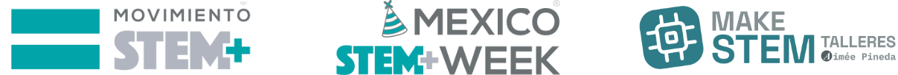
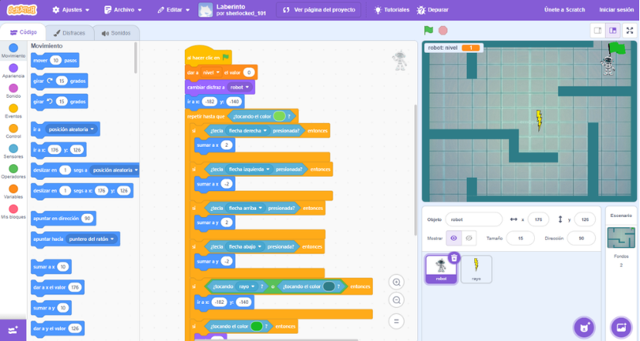

# CREACIÓN DE VIDEOJUEGOS CON SCRATCH | TALLER #MéxicoSTEMWeek

**México STEM Week 2026 · Taller 01 · Programación creativa**

El taller introduce los fundamentos de los algoritmos y la programación mediante la creación de un videojuego de laberinto con Scratch. Se programa un personaje, se incorporan obstáculos y se establece una meta mediante el uso de eventos, variables, condicionales y ciclos. La actividad promueve el pensamiento lógico, la creatividad y la resolución de problemas mediante ejercicios prácticos.

## Índice

- [Información de la actividad](#información-de-la-actividad)
- [Requisitos](#requisitos)
- [Reto](#reto)
- [Conceptos de programación para el taller](#conceptos-de-programación-para-el-taller)
  - [1. ¿Qué es un algoritmo?](#1-qué-es-un-algoritmo)
- [Temario](#temario)
- [Recursos de este proyecto](#recursos-de-este-proyecto)
- [Habilidades que se practican](#habilidades-que-se-practican)
- [Ejemplos de proyectos para continuar aprendiendo](#ejemplos-de-proyectos-para-continuar-aprendiendo)
- [Tutoriales para continuar aprendiendo](#tutoriales-para-continuar-aprendiendo)
- [Solución paso a paso: Creación de videojuegos con Scratch](#solución-paso-a-paso-creación-de-videojuegos-con-scratch)
- [¿Quién organiza e imparte?](#quién-organiza-e-imparte)
- [Más información](#más-información)
- [Licencia](#licencia)

## Información de la actividad

- **Fecha:** sábado 7 de noviembre de 2026
- **Horario:** 18:00 a 20:00 h (UTC-6)
- **Modalidad:** en línea y en vivo por YouTube
- **Transmisión en vivo:** [Creación de videojuegos con Scratch](https://youtube.com/live/IqgxJ8tYz1s?feature=share)
- **Participación:** abierta a cualquier país
- **Idioma:** español
- **Costo:** gratuito
- **Público:** general, a partir de 13 años
- **Nivel:** principiante

## Requisitos

- Una computadora con conexión a internet.
- No se requiere experiencia previa.
- Acceso a [Scratch](https://scratch.mit.edu/).

## Reto

El reto consiste en desarrollar un videojuego de laberinto en Scratch. El jugador controlará un robot que deberá encontrar la salida mientras evita las paredes y a un rayo en movimiento. Integra eventos, movimiento, condicionales, ciclos, variables y comunicación entre objetos para programar estas reglas:

1. **Movimiento del robot:** Colocar al robot en una posición inicial y permitir que se desplace por el laberinto con las flechas del teclado (arriba, abajo, izquierda y derecha).
2. **Colisiones con las paredes:** si el robot toca una pared, debe regresar automáticamente a su posición inicial.
3. **Rayo en movimiento:** Programar el rayo para que se desplace de arriba hacia abajo y viceversa entre dos posiciones. Si toca al robot, este debe regresar a su posición inicial.
4. **Cambio de nivel:** Iniciar el juego en el nivel 1. Cuando el robot llegue a la bandera verde, debe avanzar al nivel 2.
5. **Animación de victoria:** al completar el nivel, reproducir un sonido de victoria, mostrar un diálogo del robot y ejecutar una animación en la que levante la mano para celebrar.

El propósito del reto es integrar estructuras de control, eventos, movimiento, detección de colisiones y comunicación entre objetos para crear un videojuego funcional.

## **Conceptos de programación para el taller**

### **1. ¿Qué es un algoritmo?**

Es un conjunto ordenado y finito de pasos o instrucciones para resolver un problema o realizar una tarea.

**Ejemplo para llegar a la meta del laberinto:**

1. Iniciar el juego y mostrar el nivel actual.
2. Mover al personaje con las teclas.
3. Si toca una pared, regresar al inicio del nivel.
4. Si llega a la meta, avanzar al siguiente nivel.
5. Repetir los pasos hasta completar el juego.

## Temario

| Tiempo | Tema | Actividad |
| --- | --- | --- |
| 00–15 min | **Algoritmos e idea del juego** | Introducción a Scratch y planeación del recorrido del laberinto, sus obstáculos y su meta. |
| 15–40 min | **Escenario, personaje y eventos** | Diseño del laberinto y programación del movimiento del personaje con eventos. |
| 40–90 min | **Reglas, obstáculos y variables** | Construcción de la solución paso a paso con condicionales, ciclos y variables. |
| 90–110 min | **Pruebas y mejoras** | Corrección de errores, pruebas del juego y mejoras al recorrido. |
| 110–120 min | **Presentación y preguntas** | Presentación del proyecto y espacio para compartir preguntas e ideas. |

## Recursos de este proyecto

- `maze_background.png`: escenario de laberinto.
- `robot.png` y `robot_hi.png`: recursos gráficos del personaje.

## Habilidades que se practican

Algoritmos · eventos · movimiento · condicionales · ciclos · variables · pruebas y depuración · pensamiento lógico · creatividad · resolución de problemas.

## Ejemplos de proyectos para continuar aprendiendo

- [Proyectos compartidos en Scratch](https://scratch.mit.edu/explore/projects/all).
- [Proyectos iniciales de Scratch](https://scratch.mit.edu/starter-projects).
- [Ideas de proyectos de Scratch](https://scratch.mit.edu/ideas).

## Tutoriales para continuar aprendiendo

- [Tutoriales paso a paso en el editor de Scratch](https://scratch.mit.edu/projects/editor/?tutorial=all).
- [Tutoriales oficiales de Scratch](https://scratch.mit.edu/help/videos/): videos sobre juegos, historias y animaciones.

## Solución paso a paso: Creación de videojuegos con Scratch

El archivo [solución paso a paso de Creación de videojuegos con Scratch](solucion-creacion-videojuegos-scratch.md) se actualizará después de que termine la transmisión en vivo de Creación de videojuegos con Scratch.

## Encuesta de satisfacción

Después de participar en el taller, responder la [encuesta de satisfacción](https://bit.ly/4gOOIN9) permite compartir comentarios que contribuyen a mejorar las próximas actividades.

## ¿Quién organiza e imparte?

La organización e impartición del taller está a cargo de **Aimée Pineda**, EdTech Developer. [Sitio web](https://emelink.vercel.app/).

## Más información

- **En vivo y más detalles:** [https://makestem.vercel.app/](https://makestem.vercel.app/)
- **México STEM Week — actividades:** [https://mexicostemweek.org/actividades/](https://mexicostemweek.org/actividades/)

## Licencia

Los materiales didácticos originales de estos talleres se comparten bajo la licencia [Creative Commons Atribución-CompartirIgual 4.0 Internacional (CC BY-SA 4.0)](https://creativecommons.org/licenses/by-sa/4.0/deed.es). La licencia permite compartir y adaptar los materiales con atribución a Aimee Pineda e indicación de los cambios; las adaptaciones deben compartirse bajo la misma licencia. Los logotipos y marcas conservan los derechos de sus respectivos titulares.

Última actualización de la licencia: 6 de noviembre de 2026.

---

#STEMEstáEnTodosLados #MéxicoSTEMWeek #YoSoySTEM
